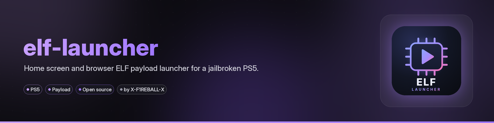
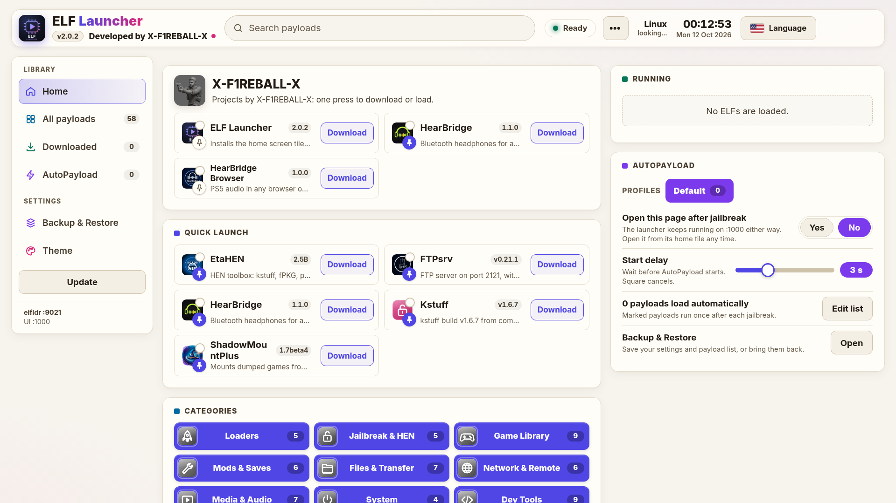
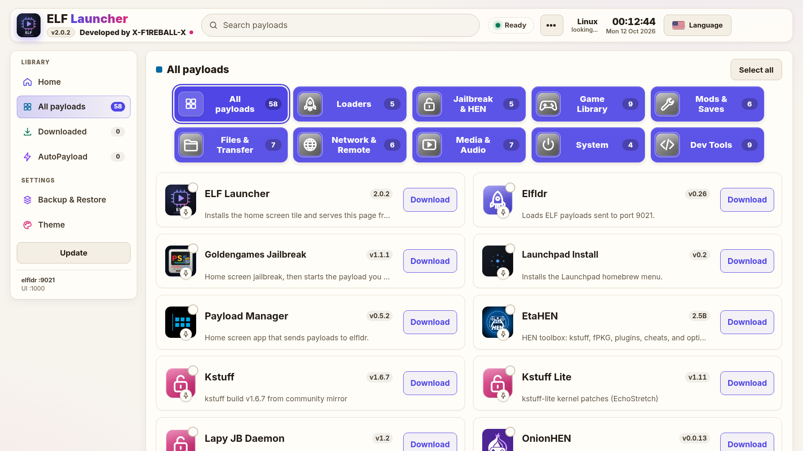
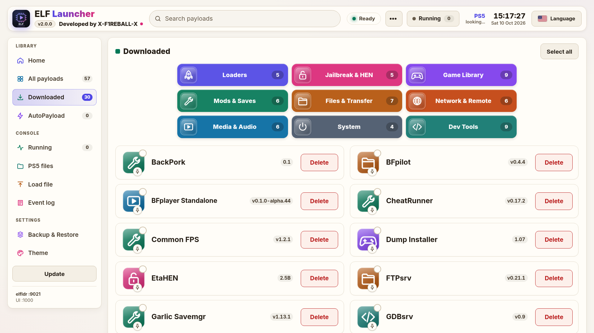
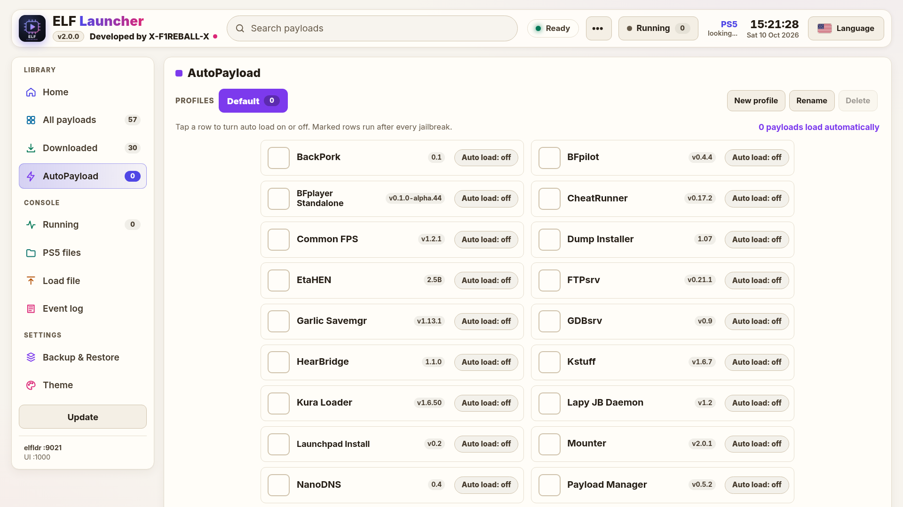
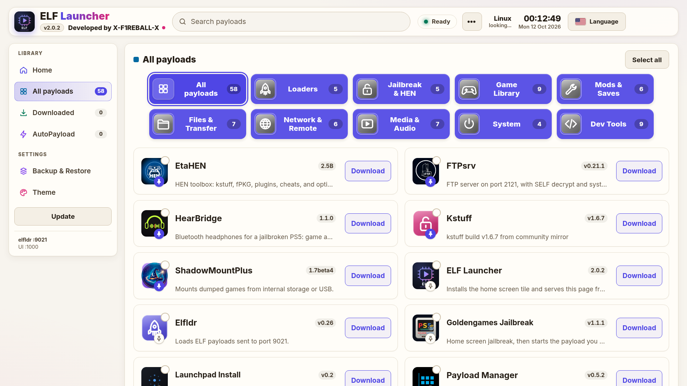
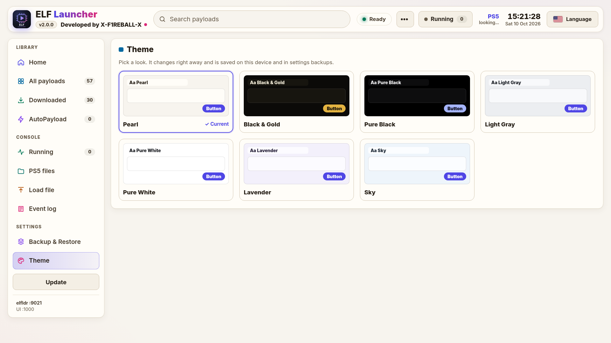

Home screen and browser ELF payload launcher for a jailbroken PS5.

## Quick start

1. Jailbreak and start elfldr on port `9021`.
2. Send `elf-launcher.elf` from the [latest release](https://github.com/X-F1REBALL-X/elf-launcher/releases/latest). It installs the home screen tile.
3. Open the tile, or `http://<PS5 IP>:1000` from your phone or PC.

Everything else is in the [guide](https://x-f1reball-x.github.io/elf-launcher/docs/guide/).

## Contents

- [Features](#features)
- [Gallery](#gallery)
- [Requirements](#requirements)
- [Installation](#installation)
- [What's new in 2.0.5](#whats-new-in-205)
- [Payload catalog and mirror](#payload-catalog-and-mirror)
- [Companion apps](#companion-apps)
- [Building from source](#building-from-source)
- [License](#license)
- [Credits](#credits)

## Features

- Home screen tile and a launcher page served by the console on port `1000`. Open it from the tile, from the PS5 browser, or from a phone or PC on the same network.
- Catalog of payloads in nine colored folders: Loaders, Jailbreak and HEN, Game Library, Mods and Saves, Files and Transfer, Network and Remote, Media and Audio, System, Dev Tools. Download once, load any time.
- AutoPayload: choose payloads that load by themselves after every jailbreak. Several profiles, a start delay from 0 to 10 seconds, and a choice between opening the page or going back to the home screen. It runs once per jailbreak.
- Quick launch: pin as many payloads as you like. Pinned payloads come first in every list.
- Updates: saved payloads are checked against their latest releases, and you can update one or all. The launcher can update itself.
- Console tools: file manager for the console, text viewer and editor with backups, running processes, event log with crash watch, and Restart, Rest mode and Power off.
- Load file: send an ELF from your phone or PC, from a USB drive, or from a path on the console.
- Backup and Restore of settings, profiles, pins and the payload list, to USB or `/data`.
- Made for the DualSense: D-pad, Cross, Circle, Square and the Options button.
- Seven themes and ten languages: English, Arabic, Spanish, French, German, Portuguese, Russian, Japanese, Chinese and Italian.
- The page works on phones and tablets.

## Gallery

Home with Quick launch, categories, power and AutoPayload:

All payloads:

Downloaded payloads:

AutoPayload with profiles:

Pinned payloads:

Themes:

## Requirements

- A jailbroken PS5 with an ELF loader (elfldr) listening on port `9021`.
- A PS5 browser, or a phone or PC on the same network, to open the page on port `1000`.
- Optional: the Windows or Android companion app, see below.

## Installation

1. Jailbreak and start elfldr on port `9021`.
2. Send `elf-launcher.elf` from the [latest release](https://github.com/X-F1REBALL-X/elf-launcher/releases/latest) to port `9021` with any payload sender, or load it from WK Autoloader. It starts the page on port `1000` and installs the Elf Launcher tile under Games.
3. Open the tile, or `http://<PS5 IP>:1000` from your phone or PC.

Updating: press Update in the launcher, or send the new `elf-launcher.elf` once. The new build takes over port `1000` from the old one, so no reboot is needed.

More details are in the [guide](https://x-f1reball-x.github.io/elf-launcher/docs/guide/).

## What's new in 2.0.5

- Opens faster. It no longer goes online every time you open it. Payload and update checks only run when you press Update, or once every 6 hours.
- `/version` now also reports the app version and the version of the copy saved on the console (`app` and `mirror_app`).

Every version has its own notes on the [releases page](https://github.com/X-F1REBALL-X/elf-launcher/releases).

## Payload catalog and mirror

The catalog is the file `payloads.json` in this repository. The launcher reads it from here.

A GitHub Actions workflow (`catalog sync`) runs every day at 03:17 UTC and can also be started by hand. It does two things:

- `tools/catalog_sync.py` checks the latest non-prerelease of each catalog payload that has a GitHub source. When the sha256 digest of the release file changed, it updates the URL, sha256, size and version in `payloads.json`.
- `tools/mirror_sync.py` handles payloads that cannot be followed directly, for example because the author ships them only inside a ZIP or hosts them outside GitHub. It downloads the newest file from the author, checks the sha256 digest when one is published, uploads the ELF to the [`payload-mirror`](https://github.com/X-F1REBALL-X/elf-launcher/releases/tag/payload-mirror) release and updates `payloads.json`.

The workflow only commits `payloads.json` when something changed. It never touches the `elf-launcher.elf` entry, which ships with the app release.

Payloads in the catalog belong to their authors. Each entry links to the author's own release or to the mirror copy.

## Companion apps

Both apps open the launcher page from your console in a native window. They are attached to the [latest release](https://github.com/X-F1REBALL-X/elf-launcher/releases/latest).

- Windows (`clients/windows`): a window that hosts Microsoft Edge WebView2 and loads `http://<console IP>:1000/`. It needs the WebView2 Runtime. When the console cannot be reached it offers the bundled page.
- Android (`clients/android`): asks for the PS5 IP once, opens `http://<IP>:1000`, and falls back to the bundled page when the console cannot be reached. Long-press anywhere to change the IP.

## Building from source

Only the pieces below have build files in this repository. The released files are the supported way to install.

- Console payload (`host/hbinstall`): `make` with the PS5 Payload SDK. The Makefile needs `PS5_PAYLOAD_SDK` set and the elfldr sources at `/tmp/elfldr-src`.
- Windows app (`clients/windows`): `build.sh` cross-compiles with Go and `go-winres`. It copies the current `index.html` into the app.
- Android app (`clients/android`): `build.sh` runs Gradle `assembleRelease` and bundles the current `index.html` as the offline page. A signed release APK needs a keystore that is not part of the repository.

## License

The `LICENSE` file contains the GNU General Public License, version 3.

Payloads in the catalog are not part of this project. They keep their own authors and licenses.

## Credits

- [elfldr](https://github.com/ps5-payload-dev/elfldr) by ps5-payload-dev. The repository includes the official `elfldr-ps5.elf` loader, and the console payload is built with elfldr sources.
- [PS5 Payload SDK](https://github.com/ps5-payload-dev/sdk) by ps5-payload-dev, used to build the console payload.
- [go-webview2](https://github.com/jchv/go-webview2) by jchv, used by the Windows app.
- Payload icons are the original icons of each project. The sources are listed in [`icons/payloads/SOURCES.md`](icons/payloads/SOURCES.md).
- The SHA-256 routine in the console payload is a compact public-domain implementation.

Developed by X-F1REBALL-X.

[Support the project on Ko-fi](https://ko-fi.com/xf1reballx). The project stays free and open source.
