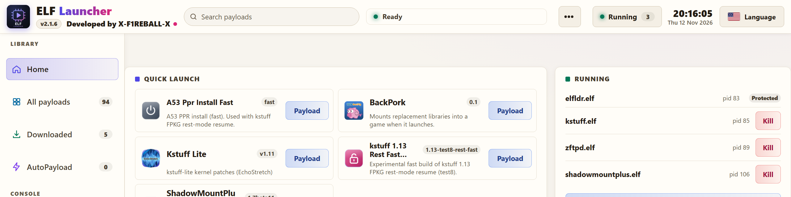
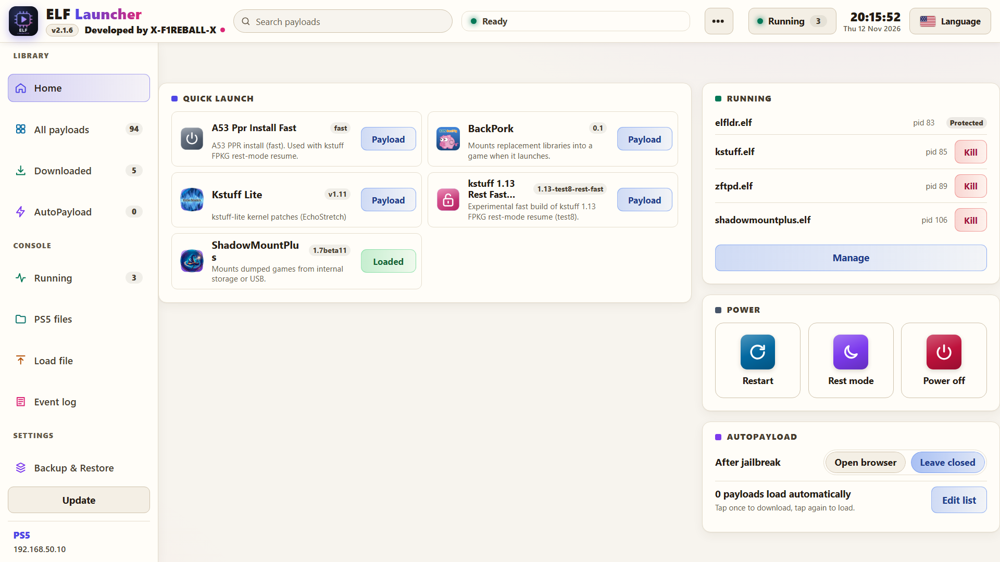
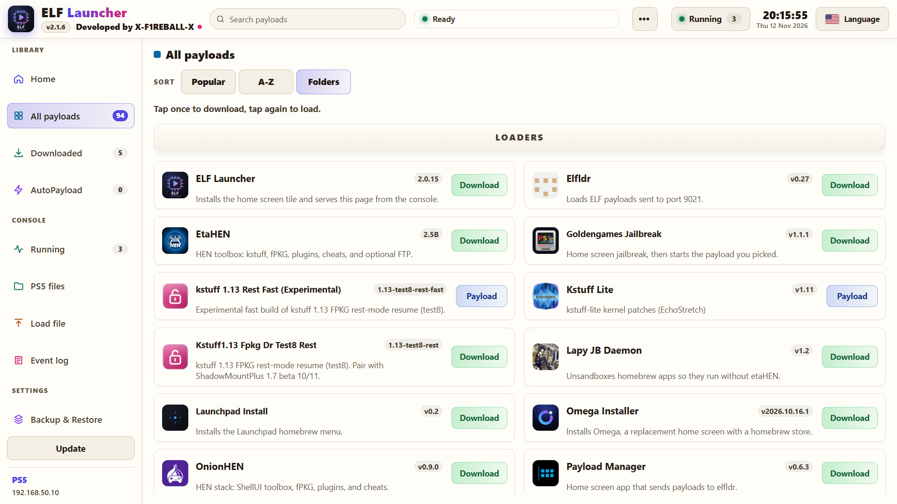
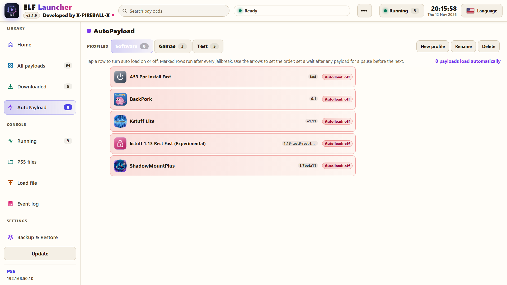
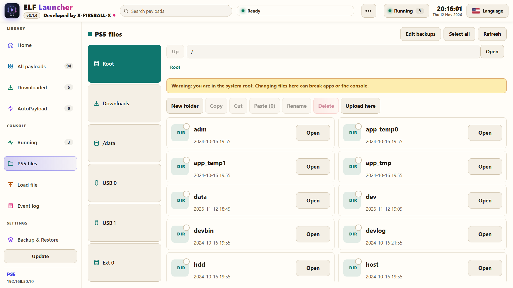

Home screen and browser ELF payload launcher for a jailbroken PS5.

## Quick start

1. Jailbreak and start elfldr on port `9021`.
2. Send `elf-launcher.elf` from the [latest release](https://github.com/X-F1REBALL-X/elf-launcher/releases/latest). It installs the home screen tile.
3. Open the tile, or `http://<PS5 IP>:1000` from your phone or PC.

The full [guide](https://x-f1reball-x.github.io/elf-launcher/docs/guide/) has more detail.

## Features

- Home screen tile and a page on port `1000`, from the tile, the PS5 browser, or a phone or PC on the same network.
- Catalog of payloads. Download once, load any time. Popular is sorted by GitHub stars.
- AutoPayload after every jailbreak, with profiles and a start delay. Pin payloads for Quick launch.
- Updates for saved payloads, and the launcher can update itself.
- PS5 Files, a text editor, Running, an event log, plus Restart, Rest mode and Power off.
- Load an ELF from your phone or PC, from USB, or from a path on the console.
- Backup and Restore. Made for the DualSense. Ten languages. Works on phones and tablets.

## Gallery

Home, with Quick launch, Running, power and AutoPayload:

All payloads:

AutoPayload with profiles:

PS5 Files, including Root:

## What's new in 2.1.6

- Cleaner top bar and Library, with the console IP at the bottom and status messages shown in full.
- PS5 Files: Root lists all folders and files, text files can be edited, and write or delete work where the console allows it.
- Clear log also clears Recent in Load file. Popular is sorted by GitHub stars, and the old WK Autoloader entry is gone.

Every version has notes on the [releases page](https://github.com/X-F1REBALL-X/elf-launcher/releases).

## More

- The catalog is `payloads.json`. A daily workflow updates release URLs and a [payload mirror](https://github.com/X-F1REBALL-X/elf-launcher/releases/tag/payload-mirror) for files that cannot be followed directly.
- Windows and Android companion apps are attached to the [latest release](https://github.com/X-F1REBALL-X/elf-launcher/releases/latest). They open the console page in a native window.
- Build files for the console payload and the companion apps are in the repository. The released files are the supported way to install.

## License

The `LICENSE` file contains the GNU General Public License, version 3.

Payloads in the catalog are not part of this project. They keep their own authors and licenses.

## Credits

- [elfldr](https://github.com/ps5-payload-dev/elfldr) by ps5-payload-dev. The repository includes the official `elfldr-ps5.elf` loader, and the console payload is built with elfldr sources.
- [PS5 Payload SDK](https://github.com/ps5-payload-dev/sdk) by ps5-payload-dev, used to build the console payload.
- [go-webview2](https://github.com/jchv/go-webview2) by jchv, used by the Windows app.
- Payload icons are the original icons of each project. The sources are listed in [`icons/payloads/SOURCES.md`](icons/payloads/SOURCES.md).
- The SHA-256 routine in the console payload is a compact public-domain implementation.

Developed by X-F1REBALL-X.

[Support the project on Ko-fi](https://ko-fi.com/xf1reballx). The project stays free and open source.
